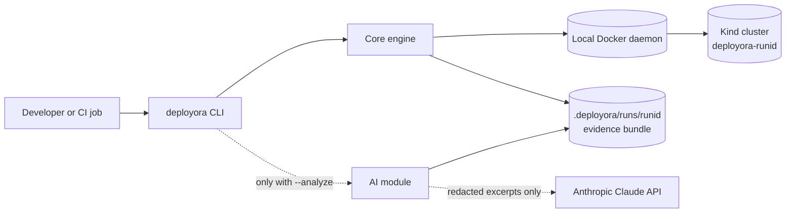

# Deployora: Architecture Overview

Status: Revision 4, draft for founder review (incorporates two rounds of principal-engineer review feedback, plus the Revision 4 rebrand and error-classification corrections)

Companion docs: `../decisions.md` (why), `../competitor-analysis.md` (market), `../roadmap.md` (when)

This document describes planned architecture and design intent. It is not a statement of what is implemented. Where a claim depends on external behavior that has not been verified, it is marked `[K]` (verify) or `[assumption]`.

> **Revision 2 summary.** v0.1 is now a local, CLI-only product that one developer can ship: no server, no database, no dashboard. Claude analysis is the last milestone of v0.1, gated on a stable core. The document now states plainly that **Kind is not a security boundary**, defines a precise run-outcome classification and exit codes, sets evidence retention and upload limits, and specifies how the GitHub Action runs in v0.1. Remote execution, REST API, PostgreSQL, workers and the dashboard are deferred behind explicit entry gates (section 12).

> **Revision 3 changes (scope unchanged).** (1) `ReadOnlyCluster` is documented as a code-level restriction, not RBAC or a security boundary, and the Kind kubeconfig's elevated permissions are stated (sections 8.1, 13). (2) Collect, report and teardown are *wind-down stages* whose problems are always warnings, never outcome changes, for every outcome (sections 6.1, 6.4, 6.5). (3) Deploy errors are classified by cause: admission rejection and invalid workload configuration are `failed`, API-server or infrastructure errors are `errored`, deadline overruns are `timed_out` (sections 6.3, 16; refined in Revision 4). (4) Redaction is documented as defense-in-depth with explicit limits and explicit user warnings before data is sent to Claude (sections 9.1, 11, 13).

> **Revision 4 changes (scope unchanged).** (1) **Rebrand:** the product is renamed from KubeTrial AI to Deployora everywhere: CLI, `deployora.yaml`, `.deployora/`, `deployora-action`, the `deployora-` cluster name prefix, diagrams, and repository paths. (2) **Kubernetes error classification** (sections 6.3, 16, 19, 20): an HTTP 403 is no longer assumed to be an admission rejection. It is split into admission or policy rejection (`failed`), RBAC or authentication failure against Deployora's own cluster credentials (`errored`), and unrecognized 403 (`errored`, never guessed). A Conflict is no longer assumed to be invalid workload configuration: optimistic-concurrency conflicts are retried (each retry re-fetches the latest object state first) and then `errored`, and AlreadyExists is attributed to the user's manifests only when the submitted objects show the duplicate. An unreachable, timed-out or failing admission webhook backend is no longer treated as an admission rejection: only an explicit denial is `failed/admission_rejected`, while a webhook call failure is `errored/webhook_unavailable` unless the submitted chart itself declares both the webhook and its backing Service, in which case it is `failed/invalid_workload_config`. Classification is documented as using typed API errors and status details first, with message shapes used only where Kubernetes provides no structured discriminator. The six outcomes and their exit codes are unchanged. (3) The document's markdown formatting was cleaned. No other architecture, scope, security-boundary or lifecycle change was made.

## 1. Purpose and scope

Deployora answers: **"Will this deploy and run healthy on a clean, throwaway Kubernetes cluster, and if not, why?"**

**v0.1.0 does exactly this, locally:** validate manifests or a Helm chart with kubeconform, create a Kind cluster, deploy, run readiness and service checks, collect redacted evidence, write JSON and HTML reports, and tear everything down.

**Not in v0.1.0:** Claude failure analysis (planned for a later v0.1.x release, once the core is stable), REST API, PostgreSQL, job workers, remote execution, React dashboard, runner adapters, remediation approval workflow, bring-your-own-cluster, any hosted or shared service.

## 2. Design principles

1. **Deterministic core, optional AI.** The engine never imports the AI package. A run is complete and useful with no Claude key.
2. **Evidence first.** Every run writes a bundle. Reports and AI read the bundle, never the cluster.
3. **Modular monolith, one engine.** One Go module. The CLI is a thin adapter over the engine's single entry point; a future API server will be a second adapter over the same entry point.
4. **Failed is not errored.** "Your deployment is unhealthy" and "our tooling could not run" are different outcomes with different exit codes (section 6).
5. **Orchestrate, don't reinvent.** Wrap kubeconform, Helm and Kind. No assertion DSL.
6. **Ephemeral by construction.** The tool only creates and talks to clusters it created.
7. **State the trust boundary honestly.** Kind isolates nothing from a malicious workload. The product's safety story is "you only run workloads you trust, on machines you control or that are discarded" (section 7).
8. **Earn each abstraction.** An interface exists only if it has two real implementations or is needed to fake something in tests. Everything else stays a concrete type until it hurts.

## 3. Phased scope

| Phase | Contents | Entry gate |
|---|---|---|
| **v0.1.0 (core)** | CLI; preflight; kubeconform validation; Kind lifecycle; manifest and Helm deploy; readiness and service checks; evidence collection and redaction; JSON and HTML reports; local run directories with pruning; composite GitHub Action; `doctor` and `gc` | none |
| **v0.1.x (analysis)** | `--analyze` using Claude, with payload preview, citation validation, cost caps | Core exit criteria met; redaction canary tests green; fixture suite stable; a few external users have run the core (section 18) |
| **v0.2 (remote)** | REST API, PostgreSQL, job queue and workers, authentication, remote CLI mode, event streaming | v0.1 used in the wild for a while; section 12 entry gates satisfied; single-tenant, trusted-users deployment only |
| **v0.3 (dashboard)** | React and TypeScript UI over the API | v0.2 API stable |
| **Later** | Runner adapters (Chainsaw first), proposals and approval workflow, probe-pod connectivity tests, multi-tenancy, bring-your-own-cluster | Demand validated; separate security review |

## 4. System context (v0.1)



Everything runs in one process on one machine. There is no network service and no database. The only outbound call is the optional Claude request, and only when the user asks for analysis.

## 5. Layering and dependency rules

```
cmd/deployora          wiring only
  └─ internal/cli      Cobra commands, flags, output formatting, exit codes
       └─ internal/engine   Run(ctx, Spec) -> Result   (the single use-case boundary)
            ├─ validate, cluster, deploy, verify, collect, redact, evidence, report
            └─ domain, config
       internal/ai     (invoked by cli after a run; reads a bundle)
```

Enforced in CI with an import linter (such as depguard):

- `engine` and everything it uses must not import `ai`.
- `ai` may import only `domain`, `evidence`, `redact`, `config`. It never gets a cluster client.
- `domain` imports nothing from the repo.
- `cli` contains no business logic: parse, call `engine` or `ai`, print.

There is deliberately **no separate `app` layer in v0.1**. `engine.Run` is the boundary. When the API server arrives (v0.2) and a second caller exists, extract an `app` package then. This is a change from Revision 1.

## 6. Run lifecycle and outcome classification

### 6.1 Phases

A run moves through phases in order, stopping at the first terminal cause:

1. **Preflight:** load and validate config, check prerequisites (Docker reachable, Helm and kubeconform present at supported versions), check disk space.
2. **Validate:** kubeconform on manifests, or on `helm template` output (rendered in memory, never written to disk unredacted).
3. **Provision:** create Kind cluster `deployora-<runid>` with a pinned node image.
4. **Deploy:** apply manifests or `helm install` into a fresh namespace.
5. **Verify:** run checks.
6. **Collect:** always runs once a cluster exists, including after failure, cancellation or timeout (best effort, within a reserved wind-down budget).
7. **Report:** write `report.json` and `report.html`.
8. **Teardown:** delete the cluster (skipped only with `--keep-cluster`).

Phases 1 to 5 are **verdict stages**: the first terminal cause among them fixes the run's outcome. Phases 6 to 8 are **wind-down stages**: they never change the outcome, whatever happens in them (sections 6.4 and 6.5).

Analysis is not a phase. It is a separate command or flag that runs after the run is finished.

Each stage records its own status: `passed`, `failed`, `errored`, `timed_out`, `canceled` or `skipped`. A run records exactly one **outcome**.

### 6.2 Outcomes

| Outcome | Meaning | Exit code | Retry guidance |
|---|---|---|---|
| `passed` | All executed checks passed | 0 | n/a |
| `failed` | The thing under test is unhealthy or invalid | 1 | Do not retry; fix the manifests or chart |
| `errored` | Deployora or its environment could not complete the run | 2 | Retry is reasonable; investigate if it repeats |
| `invalid_config` | The invocation or `deployora.yaml` is wrong | 3 | Do not retry; fix the config |
| `timed_out` | The run deadline or the provision stage deadline was exceeded | 4 | Retry is reasonable once; then raise limits or investigate |
| `canceled` | Interrupted by the user or CI (SIGINT or SIGTERM) | 130 | n/a |

Every outcome carries a machine-readable `reason` code and the `stage` where it happened.

### 6.3 Classification table

| Condition | Outcome | Reason | Stage | Cluster created? |
|---|---|---|---|---|
| Manifests violate schema (errors) | `failed` | `validation_failed` | validate | No |
| `helm template` fails to render the chart | `failed` | `render_failed` | validate | No |
| CRD schema missing | warning by default; with `--strict-schemas`, `failed` | `schema_missing` | validate | No |
| Unparseable config, unknown field, missing target path, unsupported Kubernetes version | `invalid_config` | `config_invalid` | preflight | No |
| Docker not running, Helm or kubeconform missing or unsupported version, disk full | `errored` | `prerequisite_missing` or `environment_error` | preflight | No |
| Kind create fails (cannot pull node image, resource exhaustion, port conflict) | `errored` | `provision_failed` | provision | Maybe (cleaned) |
| Explicit admission or policy denial: a validating or mutating webhook, a ValidatingAdmissionPolicy, or built-in admission control (for example Pod Security) responds by denying an object | `failed` | `admission_rejected` | deploy | Yes |
| Invalid workload configuration: the API server returns Invalid or BadRequest for an object; AlreadyExists for an object the submitted manifests declare more than once; unknown kind or missing CRD; Helm install or hook failure attributed to the chart; a webhook call failure for which the submitted chart itself declares both the webhook and its backing Service (concrete evidence, see the notes) | `failed` | `invalid_workload_config` | deploy | Yes |
| Authentication or RBAC authorization failure against Deployora's own cluster credentials: 401 Unauthorized, or 403 Forbidden carrying the RBAC authorizer message shape | `errored` | `authorization_failed` | the active stage | Yes |
| Conflict (optimistic concurrency, reason `Conflict`) that persists after bounded retry, where every retry re-fetched the latest object state first | `errored` | `apply_conflict` | deploy | Yes |
| Webhook call failure: an admission webhook backend is unreachable, times out or returns an unusable response (the API server reports `failed calling webhook`) while the API server is healthy, and the submitted chart is not shown to have declared both the webhook and its backing Service | `errored` | `webhook_unavailable` | deploy | Yes |
| API error Deployora cannot attribute to the workload or to a known infrastructure cause: a 403 matching neither the admission nor the RBAC shapes, NotFound, AlreadyExists not shown to be a duplicate in the submitted manifests, or an unrecognized status | `errored` | `deploy_api_error` | deploy | Yes |
| API server unavailable or unreachable (connection refused, TLS or network error, timeout, 5xx other than a webhook call failure, throttling that persists after bounded retry), or the Kind control plane or node died | `errored` | `api_unavailable` or `cluster_error` | deploy or verify, whichever was active | Yes |
| A check fails (not ready, no ready endpoints, HTTP mismatch, crash loop, Job failed) | `failed` | `check_failed` | verify | Yes |
| A check exceeds its own timeout (for example workloads not ready in time) | `failed` | `check_timeout` | verify | Yes |
| Run deadline exceeded during deploy or verify | `timed_out` | `run_deadline` | the active stage | Yes |
| Provision exceeds its stage deadline | `timed_out` | `stage_deadline` | provision | Maybe |
| SIGINT or SIGTERM | `canceled` | `interrupted` | the active stage | Maybe |
| Panic or unexpected internal error | `errored` | `internal_error` | the active stage | Maybe |
| Collect, report or teardown fails, times out or is interrupted | **outcome unchanged**; warning only (`evidence_incomplete`, `report_failed`, `cleanup_failed`, and so on; see 6.5) | n/a | wind-down | Yes |

Notes on the less obvious rows:

- **A check timeout is `failed`, not `timed_out`.** If pods do not become ready within the allowed readiness time, that is a verdict on the deployment. The report includes pull and scheduling events so a slow-registry cause is visible. `--readiness-timeout` raises the limit. The ambiguity between "broken" and "slow environment" cannot be fully removed; evidence is how users tell them apart. [assumption: validate with real charts]
- **`timed_out` covers only the run deadline and the provision stage deadline**, because those are signals about the environment or limits rather than about the workload. Collect and teardown deadlines are wind-down matters and produce warnings (6.5).
- **Deploy errors are classified by cause, not by stage.** Classification uses the client library's typed API errors (`IsForbidden`, `IsInvalid`, `IsConflict`, `IsAlreadyExists` and so on) and the status details they carry (HTTP code, `Reason`, `Details`, `Details.Causes`). A bare HTTP status code is never enough: the same code can mean different things. The order is fixed:
  1. **Context first.** A canceled context is `canceled/interrupted`. An exceeded run deadline is `timed_out/run_deadline`, at any point including mid-deploy. No API-error logic runs after either.
  2. **Transient errors are retried before they are classified:** connection resets, 429, 503, server timeouts, and Conflict with reason `Conflict` (which is retried differently, see the Conflict bullet below). Backoff is bounded (default 3 attempts over about 15 seconds), so a blip does not become an `errored` run.
  3. **Then the typed error decides**, as set out in the bullets that follow.
- **Forbidden (403) is not one condition.** Kubernetes returns the same code and reason for three different situations, and it provides no structured field that names the component that refused the request. After `IsForbidden`, the engine therefore inspects the status message, in this order:
  - *Admission or policy rejection, checked first.* The message has a shape generated by the API server's admission machinery: `admission webhook "…" denied the request`, `ValidatingAdmissionPolicy '…' … denied request`, or `violates PodSecurity "…"`. These are explicit denials, and the result is `failed/admission_rejected`. A webhook that could not be called at all is a different condition, not a denial (see the webhook bullet below). It is checked first because a webhook's own free-form message could contain words that resemble an RBAC message.
  - *RBAC authorization failure.* The message has the authorizer shape (`… is forbidden: User "…" cannot <verb> resource "…"`) or the RBAC escalation-check shape (`… is attempting to grant RBAC permissions not currently held`). The result is `errored/authorization_failed`. This is `errored`, not `failed` and not `invalid_config`, because Deployora created the cluster and holds cluster-admin credentials for it (section 8.1). An RBAC refusal therefore cannot be a verdict on the user's workload; it means a Deployora defect or an unexpected cluster state, and a repeat should be reported as a bug.
  - *Neither shape.* The result is `errored/deploy_api_error`. The status and message are kept (redacted) as evidence. The engine does not guess a category.
  - Message shapes are the only available discriminator for 403, so they are pinned by tests against recorded API server responses (section 16) and listed as a risk (section 19).
- **Unauthorized (401)** is `errored/authorization_failed`: the credentials are Deployora's own.
- **Invalid (422) and BadRequest (400)** are `failed/invalid_workload_config`, and `Details.Causes` (field and message) are copied into the report. A ValidatingAdmissionPolicy denial defaults to an Invalid status, so a policy denial can arrive here rather than as a 403. Both outcomes are `failed`; the engine applies the same admission message check first and reports `admission_rejected` when it matches.
- **Conflict (409) has two distinct reasons**, told apart by `Status().Reason`:
  - *`Conflict`* (optimistic concurrency, for example "the object has been modified") is a write race inside Deployora's own apply logic against controllers in a fresh cluster. It says nothing about the manifests. It is retried with the bounded policy above, but a retry never resends the object it read earlier, because that copy carries the stale `resourceVersion` and would fail the same way. Each attempt first re-fetches the latest state of the object (a fresh read, so the update carries the current `resourceVersion`) and re-applies Deployora's intended change to that state before updating. If the conflict persists after the bounded attempts it is `errored/apply_conflict`. It is never `invalid_workload_config`.
  - *`AlreadyExists`* is attributed using the submitted objects. If the failing object's identity (group, kind, namespace, name) is declared more than once in the submitted manifests, the result is `failed/invalid_workload_config`. Otherwise it cannot be attributed to the submission and is `errored/deploy_api_error`, with the status kept as evidence.
- **Unknown kind or missing CRD** (a REST mapping failure rather than an API status) is `failed/invalid_workload_config`.
- **API server unavailable or unreachable** (connection refused, TLS or network errors, timeouts, 5xx other than a webhook call failure, persistent throttling) is `errored/api_unavailable`, or `cluster_error` when the Kind control plane or node died. A 5xx carrying the `failed calling webhook` shape follows the webhook bullet below instead.
- **A webhook that cannot be called is not a denial.** When an admission webhook's backend is unreachable, times out or returns an unusable response, the API server returns an error (typically 500 InternalError) with a `failed calling webhook "<name>"` message. That is different from an explicit denial (`admission webhook "<name>" denied the request`), which is a decision made by the webhook. A call failure says the webhook could not decide; it is not a verdict on the manifests. After bounded retry, the engine decides in this order:
  1. If the `/readyz` probe is unhealthy or unreachable, the API server is the problem: `errored/api_unavailable`.
  2. If `/readyz` is healthy and there is **concrete evidence that the submitted chart itself caused the failure**, the result is `failed/invalid_workload_config`. Concrete evidence means all three of: the message names the failing webhook; that webhook is declared, by name, in a ValidatingWebhookConfiguration or MutatingWebhookConfiguration in the submitted manifests or rendered chart; and that webhook's `clientConfig.service` references a Service that is also declared in the submitted manifests or rendered chart. The chart then ships a webhook whose own backend is not serving (for example the backing Pod never becomes ready), which is a verdict on the chart. Matching uses object identity (kind, namespace, name), never a substring of the message.
  3. Otherwise the result is `errored/webhook_unavailable`. This covers a webhook the submission does not declare, a backend Service the submission does not declare, a URL-based webhook, and any case where the evidence is incomplete. The report records which of the three conditions was not met, so the user can see why the engine did not blame the chart.
- **Helm runs as a CLI and reports errors as text.** After any non-zero Helm exit the engine probes the API server (`/readyz`). Unhealthy or unreachable means `errored/api_unavailable`. Healthy means the failure is attributed to the chart or workload: `failed/invalid_workload_config`, with Helm's message kept as evidence, with one exception. Helm relays the API server's message in its output, so the engine looks for the `failed calling webhook` shape in it, solely to apply the webhook rule above using the rendered chart kept in memory from the validate stage; a Helm failure showing that shape follows the same three-step decision and can therefore end as `errored/webhook_unavailable`. Apart from that shape, Helm text is not parsed. The Helm path has no typed errors, so it does not try to separate admission rejection from other chart failures. For those, the outcome and exit code match the typed path and only the reason is coarser.
- **Image pull problems and crash loops** are not deploy errors; they surface in verify.

### 6.4 Rules that keep classification honest

1. **First terminal cause wins.** Verdict stages (preflight, validate, provision, deploy, verify) are sequential and stop at the first failure, error, timeout or cancellation. That first terminal cause fixes the run's outcome. If all verdict stages pass, the outcome is `passed`.
2. **Cancellation during the verdict stages wins over anything that happens after the signal.** A signal that arrives after the outcome is already fixed (during wind-down) does not change it.
3. **Wind-down stages cannot change the outcome.** Collect, report and teardown run after the verdict is fixed (or, when a verdict stage was cut short, as best-effort cleanup). A failure, error, timeout or interruption in any of them is recorded as a warning and never as an outcome. This holds for every outcome (6.5), and it is what keeps rule 1 true: the first terminal cause among the verdict stages is the only one that counts.
4. **Analysis never affects the outcome.** If Claude is unavailable, the report says `analysis: unavailable (reason)` and exit codes are unchanged.
5. **Wind-down budget.** The run deadline (default 15 minutes) reserves the last portion (default 90 seconds) for collect, report and teardown, so a timed-out or failed run still produces evidence and cleans up. The reserved budget is also wind-down's own deadline: if wind-down overruns it, the remaining wind-down work is abandoned and warnings are recorded, never a new outcome. On cancellation, wind-down gets a shorter budget (default 30 seconds). A second signal exits immediately and prints a `deployora gc` hint.
6. **Panics are recovered.** A panic in a verdict stage finalizes `run.json` with `errored/internal_error` and attempts teardown. A panic in a wind-down stage is recovered and recorded as a warning (6.5); the outcome is unchanged.
7. **Validation failures are cheap.** They stop before any cluster exists. `deployora validate` (and `run --validate-only`) exposes this fast path.

### 6.5 Wind-down failures (consistent for every outcome)

Collect, report and teardown are wind-down stages. Whatever happens in them, **the outcome and exit code are exactly what the verdict stages produced.** The only effect is a warning in `run.json`, `report.json`, the CLI output and the Action's `warnings` output.

| Wind-down problem | Warning | Notes |
|---|---|---|
| Collection fails or times out | `evidence_incomplete` | The evidence index records what is missing |
| Report cannot be written | `report_failed` | The CLI still prints the outcome summary to stdout in the requested format, so the verdict is never lost |
| Teardown fails or times out | `cleanup_failed` | Cluster name and creation time recorded; the CLI prints the exact `deployora gc` command |
| SIGINT or SIGTERM after the outcome is fixed | `wind_down_interrupted` | Remaining wind-down is shortened; a second signal exits immediately |
| Panic in a wind-down stage | `internal_error_in_wind_down` | Recovered |

| Outcome | If wind-down has trouble | Exit code |
|---|---|---|
| `passed` | stays `passed`, plus warnings | 0 |
| `failed` | stays `failed`, plus warnings | 1 |
| `errored` | stays `errored`, plus warnings | 2 |
| `timed_out` | stays `timed_out`; wind-down runs on the reserved budget and is abandoned if it overruns | 4 |
| `canceled` | stays `canceled`; shortened budget | 130 |
| `invalid_config` | no cluster exists, so collect and teardown are skipped; only a report failure is possible, handled as above | 3 |

A passed run that leaks a cluster still exits 0 on purpose. The verdict about the deployment is valid, and a CI job should not look like a deployment failure because cleanup failed. The warning is visible in the CLI output, the job summary and a step output so teams can act on it. On ephemeral runners the leak is moot; on persistent self-hosted runners the docs recommend a `gc` step (section 10).

### 6.6 Report fields

`run.json` and `report.json` include `outcome`, `reason`, `stage`, `exit_code`, per-stage statuses, failing check names, `warnings[]`, `cleanup` status, and `schema_version`. These fields and the exit codes are a public contract once v0.1 ships.

## 7. Trust model and isolation

### 7.1 Kind is not a security boundary

A Kind "node" is a Docker container, and the cluster shares the host's kernel and Docker daemon. Kind node containers run with elevated privileges. [K] Therefore a malicious or compromised workload deployed into a Kind cluster must be assumed capable of attacking the machine running Docker: through privileged pods, `hostPath` or Docker-socket mounts, kernel vulnerabilities, resource exhaustion, or by reaching networks the host can reach (internal services, cloud metadata endpoints). Kind is a convenience for disposable clusters, **not** a sandbox. Deployora must never be described, documented or marketed as isolating untrusted code.

### 7.2 Supported trust levels

| Level | Scenario | v0.1 position |
|---|---|---|
| T0 | Your own manifests or charts on your own machine | Supported |
| T1 | Your team's code on an ephemeral CI runner | Supported |
| T2 | Untrusted code (for example a fork PR) on a **GitHub-hosted, ephemeral** runner with no secrets | Supported with the warnings in section 10. The isolation comes from the discarded VM, not from Kind. |
| T3 | Untrusted code on any shared or long-lived host, including a persistent self-hosted runner or a shared public server | **Not supported.** Documented as unsafe. |

### 7.3 What v0.1 does, and does not, do about it

Does (hygiene, not a boundary):

- Prints a one-line trust notice on the first run in a directory and links to this model in user docs.
- Uses a default Kind config with no host mounts, no Docker socket exposure and the API server bound to loopback. [K: verify Kind defaults]
- Applies the run deadline and always tears down.
- Reports **workload risk notices** from a simple walk of the manifests under test: privileged containers, `hostPath`, `hostNetwork`, `hostPID`, Docker socket mounts. Informational only; it is cheap and can be cut if scope pressure demands.
- Writes evidence only after redaction, so Deployora itself never persists raw collected text. Redaction is best-effort (section 11), and a hostile workload can still do harm directly on the host, as above.

Does not:

- Offer or imply any sandboxing.
- Run any server in v0.1, so no shared-host execution path exists to misuse.

### 7.4 Rule for later versions

No hosted or public service, and no multi-user server, until an execution environment with a real isolation boundary exists (section 12.4). The first v0.2 server is for a single team running its own trusted workloads.

## 8. Component responsibilities

Phase column: **1** = v0.1 core, **1a** = v0.1.x analysis release (after v0.1.0), **2** = v0.2, **3** = v0.3.

| Component | Phase | Responsibility | Must not |
|---|---|---|---|
| `domain` | 1 | Small shared types: Run, StageResult, CheckResult, Outcome and reason codes, EvidenceRef | Contain I/O |
| `config` | 1 | Parse and validate `deployora.yaml`; produce `invalid_config` errors with line context | Read the environment beyond documented variables |
| `engine` | 1 | `Run(ctx, Spec) -> Result`: phase sequencing, deadlines, wind-down, cancellation, outcome classification (section 6) | Know about Claude, HTTP or SQL |
| `validate` | 1 | Run pinned `kubeconform` (binary, JSON output) on files or on in-memory rendered Helm output; normalize results; flag missing schemas | Reach the network for schemas unless configured |
| `cluster` | 1 | `ClusterProvider` with the Kind implementation; kubeconfig isolation; naming and labels; production guard; `gc` | Read the user's default kubeconfig |
| `deploy` | 1 | `Deployer` with manifest and Helm implementations; namespace management; typed API error capture for classification, and re-fetch of the latest object state before each Conflict retry (section 6.3) | Persist Helm values or rendered Secrets |
| `verify` | 1 | `Check` interface and built-in checks: workload readiness, restarts and crash loops, Job completion, Service has ready endpoints, HTTP check via the API server service proxy | Mutate the cluster or use more than the read-only view (enforced by types and tests, not by credentials; see 8.1) |
| `collect` | 1 | Allowlisted, read-only gathering (events, workload and container state, bounded logs, resource snapshots); truncation and size caps | Read Secrets |
| `redact` | 1 | Structural scrubbing and pattern redaction; the only path by which collected text reaches disk or the AI module | Be bypassable by callers, or be described as a guarantee of completeness |
| `evidence` | 1 | Bundle layout, writer and reader, evidence IDs, size budgets, retention pruning | Hold cluster clients |
| `report` | 1 | `report.json` (versioned schema) and self-contained, escaped `report.html` | Fetch remote assets |
| `cli` | 1 | Commands: `run`, `validate`, `report`, `history`, `delete`, `prune`, `gc`, `doctor`; exit codes; `--output json` | Contain business rules |
| `ai` | 1a | Evidence selection, prompt building, Claude client, JSON validation, citation checking, cost caps, payload preview | Execute anything; touch a cluster |
| `app`, `store` (Postgres), `server`, `worker`, `api` | 2 | Extracted when the second caller (API) exists; see section 12 | Exist before v0.2 |
| `web` | 3 | React dashboard | Ever see an Anthropic key |

### 8.1 Interfaces kept, and why

```go
type ClusterProvider interface {            // one impl (Kind); kept so the engine can be tested with a fake
    Create(ctx context.Context, spec ClusterSpec) (Cluster, error)
    Delete(ctx context.Context, c Cluster) error
    List(ctx context.Context) ([]ClusterInfo, error)   // for gc
}

type Deployer interface {                   // two impls: manifests, Helm
    Deploy(ctx context.Context, c Cluster, src Source) (Deployment, error)
}

type Check interface {                      // many impls; the extension point for later runner adapters
    Name() string
    Run(ctx context.Context, env CheckEnv) CheckResult  // CheckEnv exposes a read-only cluster view only (a code-level restriction, see below)
}

type Analyzer interface {                   // tiny; exists for a fake in tests, not for multiple providers
    Analyze(ctx context.Context, in AnalysisInput) (Analysis, error)
}
```

`ReadOnlyCluster` (get, list, logs only) is a narrow Go type handed to checks and collectors.

**`ReadOnlyCluster` is a code-level interface restriction. It is not Kubernetes RBAC and not a security boundary.**

- **What it does:** it prevents *accidental* mutation. Code written against the type cannot call a write method without a compile error, and a recording fake in tests asserts that checks and collectors issue only GET, LIST and log requests. It protects against our own bugs and keeps review simple.
- **What it does not do:** the kubeconfig the process holds for the local Kind cluster carries cluster-admin credentials, because Deployora created the cluster and the deployer must write to it. Any code running inside the Deployora process (a bug, a compromised dependency, or a future third-party check or adapter) can obtain those credentials and ignore the interface. The type also does nothing against a hostile workload (section 7) or against anyone with access to the host.
- **Credential handling:** the kubeconfig is written to a private working directory (directory mode 0700, file mode 0600) **outside the evidence bundle**. It is never copied into the bundle or uploaded as an artifact, is passed explicitly to subprocesses, and is deleted at teardown on a best-effort basis. Because the cluster is destroyed at teardown, a leftover file is useless afterward, but it is valid until then.
- **What real least privilege would take:** separate credentials per stage, for example a read-only ServiceAccount token for verify and collect. That is deferred. Even then the boundary would only be as strong as the process and host holding the admin credentials.
- **The actual v0.1 boundaries** are that the cluster is ephemeral, local and loopback-bound, and that the host is yours or a discarded runner (section 7).

### 8.2 Abstractions removed or deferred from Revision 1

- `Store` interface and the file and Postgres implementations: removed for v0.1. History is the set of bundle directories on disk. The interface is introduced in v0.2 when Postgres exists.
- `Collector` interface: removed. Collectors are plain functions in `collect`.
- `Reporter` interface: removed. Two concrete writers.
- `app` use-case layer: deferred to v0.2 (section 5).
- Proposal records and the approval command: deferred (section 11).
- `pkg/`, public Go API: none.

## 9. Evidence bundle, retention, limits and deletion

### 9.1 Layout (versioned by `schema_version`)

```
.deployora/                      created with its own .gitignore containing "*"
  runs/<run-id>/
    run.json                     outcome, reason, stages, check results, warnings
    validation.json              kubeconform results (+ risk notices)
    rendered/                    rendered manifests, Secret documents removed, env and ConfigMap data values masked
    events.json                  Kubernetes events, Warning-first index
    workloads/<kind>-<n>.json    status, container states, restarts, last termination
    logs/<pod>-<container>.log   redacted, tail-limited, size-capped
    evidence-index.json          stable IDs (ev:event:12, ev:log:web-0:app), truncation records
    report.json  report.html
    analysis.json                only if analysis ran
    analysis-request.json        the exact redacted payload sent to Claude, kept for audit
```

**Raw data never touches disk.** Logs, events and rendered manifests are redacted in memory before they are written. The only places raw data exists are process memory and the live cluster. This is a firm rule: it makes retention and deletion simple and limits the damage of an accidentally shared bundle. It is a rule about *when* redaction happens, not a claim that redaction is complete: a bundle can still contain sensitive text that pattern redaction missed (section 11). Treat bundles as potentially sensitive artifacts.

### 9.2 Size limits (defaults, configurable, to be tuned with real runs) [assumption]

| Item | Default |
|---|---|
| Log tail per container | 200 lines and 256 KiB, whichever is smaller |
| Events kept | 2,000 most recent |
| Rendered manifests | 5 MiB total |
| Whole bundle hard cap | 25 MiB |

Anything dropped is recorded in `evidence-index.json` as a truncation record (what, how much), so reports and analysis can say "logs truncated".

### 9.3 Retention (local)

- Applied automatically at the end of each run: keep the newest **20 runs**, at most **14 days**, at most **500 MiB** total; oldest are pruned first.
- `deployora run --keep` pins a run against automatic pruning. `deployora prune` applies the policy on demand; `deployora delete <run-id>` removes a run explicitly (pinned or not).
- Pruning and deletion remove the run directory recursively. This is file removal, not secure erasure. Because bundles contain only redacted data, that is acceptable for v0.1.
- `--keep-cluster` is the exception to "nothing sensitive lingers": the live cluster holds raw data until it is removed with `deployora gc`. It prints a warning saying so.
- Analysis requests sent to Anthropic are governed by the user's own Anthropic agreement. Deployora cannot delete them and the docs must say so.

### 9.4 Input limits (v0.1, local input)

The same sanity limits later become the upload limits for the server (section 12.3). In v0.1 they protect against pathological local input:

- At most 2,000 manifest files and 25 MiB of YAML per run; a single file over 10 MiB is rejected.
- Helm chart dependencies must already be vendored in `charts/`; Deployora does not run `helm dependency update` implicitly (it can pull from the network).
- Symlinks that resolve outside the target directory are rejected.

Exceeding a limit is `invalid_config`, with the limit named in the message.

### 9.5 Evidence in CI

Bundles uploaded from CI are subject to the CI system's own access and retention rules; see section 10.

## 10. GitHub Action execution model (v0.1)

**Model: a composite action that runs the CLI directly on the CI runner, using that runner's Docker and a Kind cluster created locally.** No Deployora server, no remote execution, no service containers.

```
job (ubuntu runner with Docker)
 ├─ caller: actions/checkout
 └─ deployora-action (single composite step sequence)
      1. install deployora (pinned version, checksum verified)
      2. deployora doctor            # checks Docker, Helm, kubeconform; fails as errored if missing
      3. deployora run --output json --report-dir <dir> ...
      4. write job summary from report.json (check table, outcome, reason; short, escaped excerpts)
      5. upload evidence bundle per policy
      6. set step outputs: outcome, reason, exit-code, warnings, report-path
```

Design points:

- **Runner requirements:** Docker available and Helm available. GitHub-hosted Ubuntu images are believed to ship Docker, Helm and Kind, but the action does not rely on that: `doctor` verifies, and an `install-tools` input fetches pinned Helm and kubeconform with checksum verification when missing. [K: verify current runner images]
- **Exit behavior:** the step exits with the CLI's exit code (section 6.2). Workflows decide what to do with `errored` and `timed_out` (for example retry) via step outputs and standard `continue-on-error` or retry patterns.
- **Deadlines:** the CLI's run deadline (default 15 minutes) must be shorter than the job's `timeout-minutes`, so Deployora can collect evidence and tear down before the runner kills the job. Docs recommend job timeout at least deadline plus 5 minutes.
- **Cancellation:** GitHub cancels with a signal followed by a hard kill after a short grace period. [K] The CLI handles SIGINT and SIGTERM with the short wind-down budget. GitHub-hosted runners are discarded afterward anyway. Composite actions cannot define post steps [K: verify], so for self-hosted runners the docs recommend an extra `if: always()` step running `deployora gc`.
- **Matrix runs:** one Kubernetes version per matrix job; each job is its own runner and its own Kind cluster. No cross-job coordination.
- **Evidence upload:** `upload-bundle: on-failure` (default), `always` or `never`; `retention-days` default 7. **Warning in docs:** in public repositories, workflow artifacts are readable by anyone who can read the repository. The bundle is redacted, but teams should still choose `never` for repositories whose manifests or log shapes are sensitive.
- **Claude analysis in CI:** off by default. When enabled, the API key comes from a repository secret passed as an input and is exposed only to the analysis step. Because CI logs are rarely read, sending also requires the explicit `analysis-acknowledge: true` input (section 11). On fork pull requests secrets are unavailable, so analysis is skipped with `analysis: skipped (no key)`, which does not change the outcome.
- **Untrusted pull requests:** document that workflows must not use `pull_request_target` with a checkout of untrusted code, and that fork PR code on persistent self-hosted runners is level T3 and unsupported (section 7.2).
- **Job summary safety:** summary content derived from logs is escaped and limited to short excerpts; the full evidence lives in the artifact.

Illustrative workflow (usage sketch):

```yaml
jobs:
  trial:
    runs-on: ubuntu-latest
    timeout-minutes: 25
    steps:
      - uses: actions/checkout@v4
      - uses: <org>/deployora-action@v0
        with:
          config: deployora.yaml
          upload-bundle: on-failure
```

## 11. AI subsystem (v0.1.x, after the stabilization gate)

Starts only when the gate in section 3 is met. Shipped behind `--analyze`, off by default. The `--analyze` flag does not exist in v0.1.0; it is added with this release, so no version ships a flag that does nothing.

Flow:

1. **Select evidence deterministically** from the bundle: failed checks, Warning events, non-ready workloads and their owners, names of related Services and ConfigMaps, last log lines of failing containers, validation errors.
2. **Redact again** at the boundary (defense in depth).
3. **Preview:** `--analyze --dry-run` prints exactly what would be sent, with a size estimate. Actual sending requires `--analyze` without `--dry-run`.
4. **Call Claude** from the CLI process using the user's own `ANTHROPIC_API_KEY`. The model name is configuration. The exact structured-output mechanism is chosen when this module is built, after reading the current API documentation. [assumption]
5. **Validate** the JSON against a schema. A claimed root cause must cite evidence IDs that exist in the bundle's index; claims with invalid citations are dropped. One automatic repair retry, then degrade to `analysis: unavailable`.
6. **Persist** `analysis.json` in the bundle and render it in the report.

Output shape (sketch): `summary`, `root_causes[] {id, title, confidence, evidence_refs[], explanation}`, `suggestions[] {root_cause_id, kind, description, suggested_change, risk}`, `unknowns[]`.

**Remediation in v0.1 is advice, nothing more.** Suggestions appear in the report as text and optional diff snippets. Deployora has no apply capability: it never edits the user's files and never applies anything to any cluster. The human-approval requirement is satisfied because a human must make every change by hand. The proposal record model and an explicit approval command arrive only if and when Deployora gains the ability to write a patch file (post-v0.1), and that command will require explicit approval and be audited.

**Redaction is defense-in-depth, not a guarantee.**

- **Guaranteed by construction:** Kubernetes Secret resources are never collected or sent; Secret documents are dropped from rendered manifests; env var values and ConfigMap data values are masked by default; Helm values files are never included.
- **Best-effort only:** pattern-based redaction of free text such as logs, event messages, annotations, labels and anything a workload prints. It cannot detect every sensitive value: unusual token formats, secrets embedded in URLs, JSON or base64 blobs, personal data, internal hostnames and proprietary business data can all pass through.
- **What we claim, and do not claim:** the evidence slice sent to Claude is limited by allowlist-first selection, and known secret shapes are redacted and covered by canary tests. Deployora never claims that redacted output is free of sensitive data.
- **User warnings (required behavior):**
  1. Every non-dry-run `--analyze` prints a notice before sending: the categories of data sent, that redaction is best-effort and may miss values, the `--dry-run` hint, and that the data goes to Anthropic under the user's own agreement. In an interactive terminal the user must confirm.
  2. In non-interactive environments nobody reads the notice, so sending requires explicit acknowledgment: `--accept-data-sharing` (Action input `analysis-acknowledge: true`). Without it, analysis is skipped with `analysis: skipped (not acknowledged)`, and the outcome is unaffected.
  3. The exact payload sent is saved in the bundle as `analysis-request.json` so it can be audited afterward.
  4. The report's analysis section states that content was sent to Claude and that redaction is best-effort.
  5. The user docs page "What is sent to Claude" repeats all of this and recommends not enabling analysis for workloads that print sensitive data.

Failure behavior: unavailable, rate-limited, timed out, over budget or invalid output all produce `analysis: unavailable (reason)`; outcome and exit code are unchanged.

Controls: per-run token cap and bounded input; prompts as versioned files in the repo; a small fixture set of broken deployments with expected diagnoses run manually (`make eval`) to check changes. A scheduled, cost-capped CI eval is later work. The model receives text and returns JSON; no tools are enabled.

## 12. Deferred designs (v0.2 and later)

These are recorded so v0.1 does not paint us into a corner. They are **not** commitments until their gates pass.

### 12.1 Summary of what is deferred and the retained decisions

- **REST API (v0.2):** OpenAPI-first (`api/openapi.yaml`), generated Go stubs and TypeScript client, bearer tokens stored hashed, roles `viewer`, `runner`, `approver`, server-sent events for progress. Endpoints cover runs, reports, bundles, analysis, health and metrics.
- **PostgreSQL (v0.2):** run history, stage and check results, analyses, API tokens, audit log; artifact blobs on a volume. Introduce the `Store` interface here, with the existing bundle-directory reader as the local implementation, and contract tests across both.
- **Workers and queue (v0.2):** jobs claimed with `FOR UPDATE SKIP LOCKED`; no Redis or broker.
- **Remote execution (v0.2):** the CLI or Action uploads an archive; the server does **not** clone git repositories (no stored repo credentials).
- **Dashboard (v0.3):** React and TypeScript over the API only; no AI key, no direct provider calls.

### 12.2 v0.2 entry gates

1. A decided execution environment for workers that does not share a Docker daemon with the API process or with other runs.
2. First deployment story limited to **single-tenant, trusted-users** use (a team running its own workloads, T0 or T1).
3. Upload limits (12.3) and retention and deletion (12.5) implemented and tested.
4. A structured threat-model review of the server, workers and archive handling.
5. The v0.1 report schema and exit codes proven stable in real use.

### 12.3 Archive upload limits (server, required before any upload endpoint ships)

| Limit | Default |
|---|---|
| Compressed archive size | 25 MiB |
| Uncompressed size | 100 MiB, with a compression ratio cap of 100:1 |
| File count | 5,000 |
| Single file size | 10 MiB |
| Path rules | No absolute paths, no `..`, maximum depth 12, no device files |
| Links | Symlinks and hardlinks rejected |
| Formats | `.tar.gz` and `.zip` only |
| Extraction | Into a fresh per-run directory, streaming with counters, aborted at the first violation |
| Request limits | Per-token rate limit and concurrent-run quota |

### 12.4 Future tenant isolation requirements (before any multi-tenant or public service)

1. **Execution isolation:** each run in a fresh, single-use VM or an equivalent hard boundary, with no shared Docker daemon between runs or tenants and no long-lived credentials on the host. Whether Kind inside such an environment is workable needs a spike. [assumption]
2. **Network controls:** egress policy blocking internal networks and cloud metadata endpoints; per-run bandwidth and connection limits.
3. **Resource controls:** CPU, memory, disk, process and time quotas per run and per tenant.
4. **Data isolation:** `tenant_id` on every record and every query, enforced with PostgreSQL row-level security as a second layer; per-tenant artifact prefixes and encryption keys; no cross-tenant caching anywhere, including the AI layer.
5. **Secrets:** Anthropic keys bring-your-own per tenant, stored encrypted, never returned by any API, never logged.
6. **Authorization:** tenant-scoped tokens and roles; approval actions restricted to the approver role and audited.
7. **Retention and deletion:** per-tenant retention policy; deletion removes metadata, artifacts and analyses; the audit log keeps the event but not the content; deletion semantics for backups documented.
8. **Operability:** per-tenant rate limits, abuse detection, an incident process, and a documented security contact.
9. **Precondition:** an external security review before multi-tenancy is enabled.

### 12.5 Server retention and deletion (required for v0.2)

Configurable per-instance retention (days and size), a background pruner, an explicit `DELETE /v1/runs/{id}` that removes rows and artifacts, and the same rule as v0.1: only redacted data is stored.

## 13. Security architecture (v0.1)

| Requirement | Control |
|---|---|
| Never expose Anthropic keys to frontend | v0.1 has no frontend or server. The key is read from the environment by the CLI only during `--analyze`, never written to the bundle or logs. In v0.2 the key stays server-side and no API returns it. |
| Never send Secrets to Claude | **Guaranteed by construction:** Kubernetes Secret resources are never collected or sent; Secret documents are dropped from rendered manifests; env and ConfigMap data values are masked; Helm values are never included. **Best-effort, not guaranteed:** sensitive values inside free text (logs, event messages, annotations). Controls: allowlist-first collection, redaction at collection and again at the AI boundary, `--dry-run` preview, saved request payload, canary-secret tests, and explicit user warnings and acknowledgment (section 11). |
| Redact sensitive log content | Pattern redaction (tokens, JWTs, cloud-style keys, private key blocks, `password=` and `Authorization:` shapes, high-entropy strings) plus mask-by-default for env and ConfigMap data values. A corpus of secret-shaped strings and a fuzz target run in CI. Redaction happens before anything is written. **Defense-in-depth only:** it cannot detect every sensitive value, so bundles and analysis payloads are treated as potentially sensitive and users are warned (section 11). |
| No unrestricted AI execution | No model tool use; model output is data; HTML output is escaped. |
| Human approval for remediation | v0.1 provides advice only and cannot apply anything. An approval command is introduced with any future feature that writes patches. |
| Least-privilege Kubernetes RBAC (partial in v0.1) | Checks and collectors receive only the `ReadOnlyCluster` type, a **code-level restriction that prevents accidental writes. It is not Kubernetes RBAC**: the process holds cluster-admin credentials for the ephemeral Kind cluster (section 8.1). Only the deployer writes, and only to a cluster the tool created. The tool needs no permissions on any pre-existing cluster. Per-stage scoped credentials are deferred. |
| Never target production clusters | Kind is the only provider. The engine never reads `~/.kube/config` or `KUBECONFIG`. It writes a private kubeconfig into a separate private working directory (outside the evidence bundle), passes `--kubeconfig` explicitly to every Helm and kubectl-equivalent call, scrubs `KUBECONFIG` from child environments, and refuses cluster names without the `deployora-` prefix. No `--context` flag exists. |
| Kind is not a security boundary | Section 7. Untrusted workloads on shared or long-lived hosts are unsupported. |

Other threats to design for: prompt injection via pod logs (logs are untrusted text; no tools; schema-validated output; escaped rendering); XSS and Markdown injection in `report.html` and the job summary (escape everything, strict CSP, no remote assets); supply chain (pinned and checksum-verified tool downloads, signed releases, SBOM); accidental commit of evidence (the `.deployora/.gitignore` file).

## 14. Repository structure

### Created for v0.1

```
deployora/
├── cmd/
│   └── deployora/              # CLI entrypoint (wiring only)
├── internal/
│   ├── domain/                 # shared types, outcome and reason codes
│   ├── config/                 # deployora.yaml parsing and validation
│   ├── engine/                 # Run(): phases, deadlines, classification
│   ├── validate/               # kubeconform integration, risk notices
│   ├── cluster/                # Provider interface, kind/, guard
│   ├── deploy/                 # manifest/, helm/
│   ├── verify/                 # Check interface; readiness/, endpoints/, jobs/, httpcheck/
│   ├── collect/                # allowlisted read-only collectors
│   ├── redact/                 # structural + pattern redaction, corpus tests
│   ├── evidence/               # bundle writer/reader, index, retention pruning
│   ├── report/                 # json/, html/ (templates embedded)
│   ├── cli/                    # Cobra commands, exit codes
│   └── ai/                     # added in the analysis milestone: select/, prompt/, claude/, schema/
├── schemas/                    # published JSON Schemas: report, evidence index, config
├── actions/
│   └── deployora-action/       # composite GitHub Action
├── test/
│   ├── fixtures/               # healthy and deliberately broken deployments, with expected outcomes
│   └── e2e/                    # real Kind tests (build tag e2e)
├── examples/
├── docs/
│   ├── architecture/           # overview.md
│   ├── decisions.md
│   ├── competitor-analysis.md
│   ├── roadmap.md
│   └── user/                   # quickstart, config reference, trust model, what is sent to Claude
├── hack/
├── .github/                    # workflows, issue and PR templates
├── Makefile
├── go.mod                      # single module
└── LICENSE  SECURITY.md  CONTRIBUTING.md  CODE_OF_CONDUCT.md  README.md
```

### Planned, do not create until their phase starts

```
internal/app/            v0.2   use-case layer extracted when the API exists
internal/store/          v0.2   Store interface; bundle-dir and Postgres implementations
internal/server/         v0.2   http/, auth/, jobs/, worker/
api/openapi.yaml         v0.2
deploy/helm/             v0.2   server chart and isolated-worker hardening guide
cmd/deployora-server/    v0.2
web/                     v0.3   React + TypeScript, generated API client
```

Empty scaffolding for later phases is intentionally absent. `GOVERNANCE.md` can wait until there is more than one maintainer.

## 15. Config sketch (`deployora.yaml`)

```yaml
version: 1
target:
  helm: { chart: ./charts/app, values: [ci-values.yaml], namespace: app }
  # or: manifests: [./k8s/]
cluster: { kubernetesVersion: "1.31" }
validate: { kubernetesVersion: "1.31.0", strictSchemas: false }
checks:
  defaults: true             # readiness, restarts/crash loops, Jobs, Services have ready endpoints
  http:                      # via the API server service proxy
    - { name: health, service: app, port: 8080, path: /healthz, expectStatus: 200 }
timeouts: { run: 15m, readiness: 5m }
evidence: { retention: { maxRuns: 20, maxAge: 14d, maxSize: 500MiB } }
```

Analysis is not configured in the file in v0.1; it is requested on the command line, so a config file cannot silently enable sending data to a third party.

Service checks in v0.1 are **endpoints ready** plus an **HTTP GET through the API server's service proxy**. That needs no extra image or pod, but it does not exercise pod-to-service networking, kube-proxy or NetworkPolicy. A probe-pod connectivity check is deferred. [assumption: confirm the proxy works for typical services]

## 16. Testing strategy

- **Unit tests** for `domain`, `config`, `redact` (with a fuzz target and growing corpus), `evidence`, `report`, and outcome classification (a table test that mirrors section 6.3 row by row).
- **Engine tests with fakes** for `ClusterProvider` and `Deployer`: deadlines, wind-down budget, cancellation, precedence rules, panic recovery.
- **Deploy classification tests** (table-driven, with a fake `Deployer` and a fake API transport), one case per distinction in 6.3. Error responses used by the fake transport are recorded from real clusters of each supported Kubernetes version where possible [assumption], so that the message shapes the classifier depends on are tested against what the API server actually returns:
  - admission denial (403 carrying an admission webhook message) gives `failed/admission_rejected`;
  - a Pod Security violation (403 carrying a `violates PodSecurity` message) and a ValidatingAdmissionPolicy denial (whether it arrives as 403 or as Invalid) give `failed/admission_rejected`;
  - a 403 whose admission webhook message contains RBAC-looking words still gives `failed/admission_rejected` (precedence);
  - a 403 with the RBAC authorizer message shape gives `errored/authorization_failed`, and so does a 401;
  - a 403 matching neither the admission nor the RBAC shapes gives `errored/deploy_api_error` with the status preserved in evidence, never a guessed category;
  - Invalid and BadRequest give `failed/invalid_workload_config`, with `Details.Causes` present in the report;
  - unknown kind or missing CRD gives `failed/invalid_workload_config`;
  - Conflict with reason `Conflict` that clears on retry does not change the outcome, and one that persists gives `errored/apply_conflict`, never `invalid_workload_config`;
  - every Conflict retry re-fetches first: a recording fake asserts that a read of the object precedes each retried update, that the retried update carries the `resourceVersion` just read (never the stale one), and that a fake which changes the object between attempts succeeds on the retry only because of the re-fetch;
  - AlreadyExists for an object declared twice in the submitted manifests gives `failed/invalid_workload_config`, and AlreadyExists not shown to be a duplicate gives `errored/deploy_api_error`;
  - connection refused, TLS error, EOF, 503, and 429 that persists past bounded retry give `errored/api_unavailable`;
  - a single transient 503 that recovers within the retry window does not change the outcome;
  - Helm non-zero exit with a healthy `/readyz` probe gives `failed/invalid_workload_config`, and the same exit with a failing probe gives `errored/api_unavailable`, and Helm output carrying the `failed calling webhook` shape follows the same webhook rule using the rendered chart;
  - a webhook that explicitly denies an object (`denied the request`) gives `failed/admission_rejected`, while the same webhook with an unreachable backend never does: the two conditions are never conflated;
  - a webhook call failure (a 500 with a `failed calling webhook` message), whether the cause is connection refused, a timeout, or an unusable response, with a healthy `/readyz` and a webhook the submission does not declare, gives `errored/webhook_unavailable`;
  - the same webhook call failure with an unhealthy or unreachable `/readyz` gives `errored/api_unavailable`;
  - a webhook call failure where the submission declares both the named webhook configuration and the Service its `clientConfig.service` points to gives `failed/invalid_workload_config`;
  - a webhook call failure where only part of that evidence exists gives `errored/webhook_unavailable`, with the unmet condition recorded in the report: the submission declares the webhook but not the Service, declares a different webhook than the one named, or the webhook is URL-based;
  - context deadline during deploy gives `timed_out/run_deadline`, and context cancellation gives `canceled/interrupted`.
- **Wind-down tests:** for every outcome crossed with {collect fails, report fails, teardown fails, teardown times out, signal during wind-down, panic during wind-down}, assert the outcome and exit code are unchanged, the expected warning is present, and the leaked cluster is recorded when teardown fails.
- **`ReadOnlyCluster` tests:** a compile-time check that the type exposes no write methods; a recording-fake test that checks and collectors issue only GET, LIST and log requests; a test that the kubeconfig is never present under the evidence bundle directory.
- **E2E tests (build tag)** on real Kind in GitHub Actions against fixtures: a healthy deployment, and broken ones (ImagePullBackOff, CrashLoopBackOff, failing readiness probe, missing ConfigMap, selector mismatch, invalid manifest, unrenderable chart, an admission-rejected object such as a bare Pod violating an enforced Pod Security level or a ValidatingAdmissionPolicy denial, and an invalid workload rejected by the API server such as a Deployment whose selector does not match its template labels, and a chart that ships both a webhook configuration and the Service behind it with a backing Pod that never becomes ready, expecting `failed/invalid_workload_config` [assumption: apply ordering is deterministic enough for a stable fixture]). One further case stops the Kind control-plane container during deploy and expects `errored/api_unavailable`; it is timing-sensitive and may run only in a nightly job. Each asserts exact outcome, reason, exit code and bundle contents. The RBAC and unrecognized-403 cases are covered by the fake API transport only, because Deployora's own cluster-admin credentials cannot produce them in an E2E run without a test-only restricted credential. The `errored/webhook_unavailable` case is covered the same way, because Deployora installs no webhook outside the submission. [assumption]
- **Security tests:** no Secret kind in any bundle; canary secrets seeded in fixtures never appear in the bundle or in a captured Claude request payload. Canary tests are regression tests for known secret shapes: they show those shapes are caught and do not prove that every sensitive value is.
- **Action test:** the composite action runs against a sample chart on a hosted runner in this repository's CI.

## 17. Observability and supportability

Structured logs (slog) with the run ID on every line; `deployora doctor` reporting Docker, Helm and kubeconform versions and reachability; `deployora gc` for orphaned clusters (labeled with run ID and creation time); a `--debug` flag that adds detail without ever printing unredacted cluster data.

## 18. v0.1 scope for one developer

**In v0.1.0:** everything marked phase 1 in section 8. **In v0.1.x:** phase 1a (analysis).

**Milestones (order matters; sizes are relative, not calendar estimates):**

| # | Milestone | Size | Done when |
|---|---|---|---|
| M1 | Skeleton, config, domain types, outcome codes, preflight and `doctor`, validate stage | M | `deployora validate` classifies fixtures correctly and CI runs lint, import rules and tests |
| M2 | Kind provider with guard and `gc`; manifest and Helm deploy | L | Fixture deploys and tears down cleanly; no orphan clusters after cancel or crash tests |
| M3 | Checks, collection, redaction, evidence bundle, engine phases with classification | L | Every row of the classification table is covered by a test |
| M4 | JSON and HTML reports, retention and prune, GitHub Action | M | Action passes on a hosted runner; stranger-run quickstart works in under 10 minutes |
| M5 | **Stabilization gate** | S to M | Core exit criteria met, canary tests green, a few external users have run it |
| M6 | Claude analysis (released as v0.1.x, after v0.1.0) | M | Preview, citation validation and graceful degradation work; manual eval set passes |

**Core exit criteria (the gate):** healthy fixture exits 0; each broken fixture exits 1 with the right failing check; a stopped Docker daemon exits 2; an invalid config exits 3; a deadline overrun exits 4 with evidence collected and cleanup done; Ctrl-C exits 130 with cleanup; no Secret or canary appears in any bundle; the entire core suite passes with no network access to Anthropic.

**Cut list if time runs short (in order):** workload risk notices, the HTTP service check, `--keep` pinning, HTML report polish (JSON first), then the Action's install-tools input.

## 19. Risks

### Technical

- **Kind startup and resource cost** on laptops and runners adds time per run and requires Docker; measure early. [assumption] Pin node images and consider Docker image caching in CI.
- **Check flakiness** (slow pulls, scheduling) erodes trust. Use explicit timeouts and backoff, and keep slow-versus-broken distinguishable in evidence.
- **CRD schema gaps** make validation noisy. Missing schemas are warnings by default with a clear message and a catalog option.
- **External tool churn** (Helm, kubeconform output formats). Pin versions; `doctor` checks them. kubeconform is run as a pinned binary with JSON output in v0.1.
- **Error classification drift:** Helm reports errors as text, so cause-based deploy classification relies on typed API errors where available, the `/readyz` probe after Helm failures, and the table-driven tests in section 16. Separating an admission rejection from an RBAC failure among 403 responses has no structured discriminator in Kubernetes, so it depends on message shapes. Those shapes can change between Kubernetes versions, and a webhook's own message text is outside Deployora's control. The mitigations are checking admission shapes before RBAC shapes, testing against recorded real responses for each supported version, and sending any unrecognized 403 to `errored/deploy_api_error` with the raw status preserved instead of guessing. Webhook failures carry a second blame risk. A webhook that cannot be called is not a denial, so blaming the chart without concrete evidence (the webhook and its backing Service both declared in the submission) would label environment problems as `failed`, while the strict evidence rule may sometimes label a real chart problem as `errored`. The engine prefers the second error, because `errored` invites a retry and an investigation instead of telling the user to change a chart that may be fine. Telling a call failure from a denial also depends on the `failed calling webhook` and `denied the request` message shapes. Misclassification would turn `failed` into `errored` or the reverse, and CI users would act on the wrong signal.
- **Log and bundle size** is bounded by caps and truncation records.
- **Redaction misses** are inevitable for novel formats, free-text secrets and non-secret sensitive data. The allowlist is the primary control; redaction is the backstop. Mitigations are explicit user warnings and acknowledgment before data is sent to Claude, the saved request payload, and treating bundles as potentially sensitive. Completeness is never claimed.
- **Single-developer bus factor:** keep scope small, tests strong, and the architecture guide current.

### Security

- Hostile workloads on a Docker host (section 7). Mitigation is a documented trust model and no shared execution, not technology.
- Secret leakage through logs or env values (section 13).
- Prompt injection and HTML or Markdown injection from log content.
- Evidence exposure through CI artifacts in public repositories.
- Supply chain for pinned tools and release binaries.
- Malicious Helm charts (templates are code-like and can be expensive to render); covered by the trust model and render deadline.

### Architectural mistakes to avoid

1. Letting `ai` or anything reach into the engine or a live cluster.
2. Building a custom assertion DSL.
3. Introducing the `app` layer, `Store`, proposals or other interfaces before a second consumer exists.
4. Building the server or dashboard before the CLI and bundle are excellent.
5. Collapsing `failed`, `errored`, `timed_out` and `invalid_config` into one failure.
6. Describing Kind as isolation, `ReadOnlyCluster` as RBAC, or redaction as a guarantee.
7. Using the user's current kube context for anything.
8. Writing raw (unredacted) data to disk "temporarily".
9. Letting the report schema or exit codes drift without versioning.
10. Making AI the headline before it is benchmarked.
11. Feature creep from the original 14-feature list into v0.1.
12. Classifying by HTTP status code alone (every 403 as admission, every 409 as invalid configuration), or treating every webhook failure as an admission rejection, instead of using typed errors and status details and separating an explicit denial from a webhook that could not be called.

## 20. Assumptions to validate

1. Kind runs acceptably on GitHub-hosted runners and typical laptops for the target Kubernetes versions.
2. Kind's default configuration has no host mounts and binds the API server to loopback.
3. kubeconform can read from stdin and its JSON output is stable enough to parse; otherwise write rendered manifests to a restricted temp directory and delete immediately.
4. The API server service proxy works for the services users want to check.
5. Hosted-runner images' current contents (Docker, Helm, Kind); composite actions' lack of post steps; cancellation signal behavior.
6. The default retention, size and timeout numbers are sensible on real charts.
7. Classifying readiness timeouts as `failed/check_timeout` matches users' expectations.
8. Zero-authoring default checks are what users want (user interviews).
9. Claude analysis quality justifies the milestone (benchmark against K8sGPT and HolmesGPT on shared fixtures).
10. The current Claude API's structured-output mechanism fits the validation design; confirm in current documentation.
11. A viable isolated execution environment exists for v0.2 workers and, later, multi-tenancy.
12. Probing `/readyz` after a Helm failure reliably separates API-server problems from chart problems, and a 3-attempt, roughly 15-second retry window is a sensible default for transient API errors.
13. Masking ConfigMap data values by default in rendered manifests does not remove diagnostic context users need; if it does, offer an explicit opt-in per key, never a default.
14. The message shapes used to split 403 and webhook-related errors (RBAC authorizer, RBAC escalation-check, webhook denial, webhook call failure, ValidatingAdmissionPolicy and Pod Security) are stable across the supported Kubernetes versions; confirm against recorded responses from each version, and extend the pattern set only through table-driven tests.
15. The 3-attempt, roughly 15-second retry window is enough for a Conflict to clear once each attempt re-fetches the latest object state; confirm on real charts.
