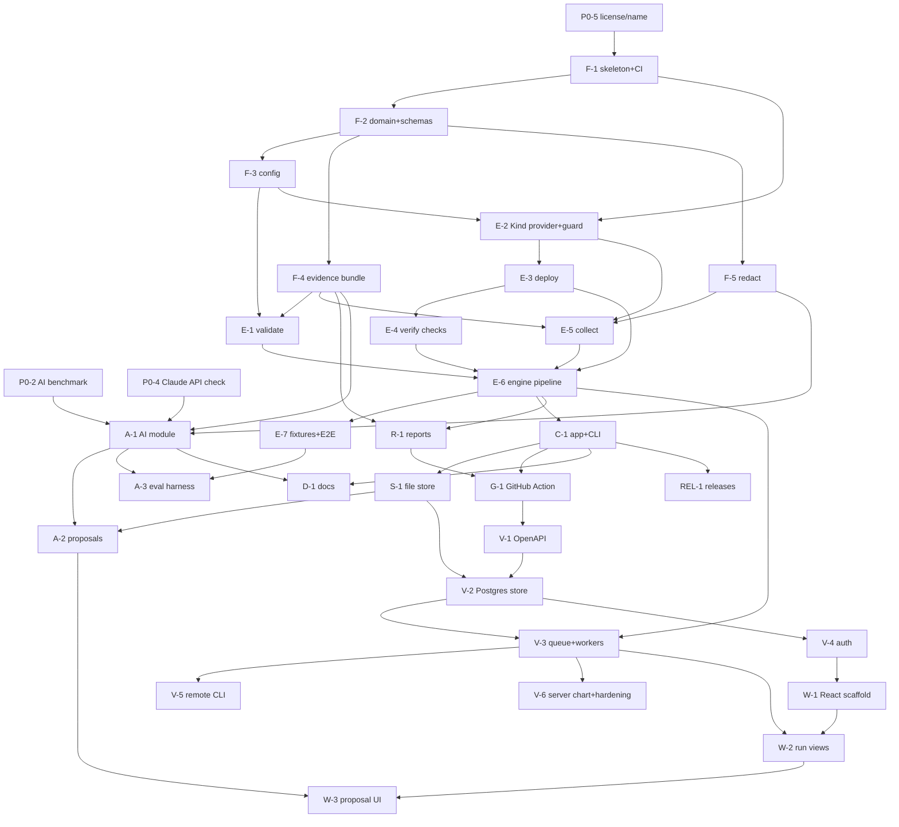

# KubeTrial AI Roadmap

Status: Draft for founder review. Effort sizes are relative (S, M, L, XL), not calendar promises. Calendar estimates depend on available hours and should be set after Phase 0.

Related: `architecture/overview.md`, `architecture/decisions.md`, `architecture/competitor-analysis.md`.

## 1. Release plan

| Release | Theme | Contents |
|---|---|---|
| **Phase 0** | Validate before building | User interviews, AI benchmark spike, repo hygiene |
| **v0.1 (MVP)** | CLI-first, local, no server | Validate, Kind, deploy (manifests and Helm), default checks, evidence bundle, JSON and HTML reports, local history, opt-in Claude analysis, GitHub Action |
| **v0.2** | Remote execution | REST API, PostgreSQL store, job queue and workers, auth, `--remote` CLI, SSE |
| **v0.3** | Dashboard | React and TypeScript UI over the API, proposal approval UI |
| **v1.0** | Stability | Schema and CLI contract freeze, docs site, security review, runner adapters begin |
| **Later** | Advanced | See section 5 |

Rationale for the order: adoption in this space comes through CLI and CI, so the dashboard and server come after the CLI is good. The server and dashboard are also where most operational and security cost lives. This changes the order implied by the original feature list, and it needs founder approval (Appendix A, Q1).

## 2. MVP scope (v0.1) mapped to the 14 planned features

| # | Feature | v0.1 | Notes |
|---|---|---|---|
| 1 | YAML validation | Yes | kubeconform on manifests and `helm template` output |
| 2 | Temporary Kind clusters | Yes | Pinned node images, `gc` for orphans |
| 3 | Helm deployment testing | Yes | Helm CLI behind `Deployer` |
| 4 | Pod readiness checks | Yes | Default check |
| 5 | Service connectivity tests | Yes (basic) | Ready endpoints plus in-cluster HTTP probe |
| 6 | Deployment smoke tests | Yes (basic) | HTTP smoke from config; Jobs completion |
| 7 | Events and log collection | Yes | Allowlist, redacted, bounded |
| 8 | Test execution history | Yes (local) | File store; Postgres arrives in v0.2 |
| 9 | HTML and JSON reports | Yes | Versioned JSON schema; self-contained escaped HTML |
| 10 | Claude root cause analysis | Yes (opt-in) | Preview, citations, schema validation |
| 11 | AI remediation suggestions | Yes (inert) | Proposals and diffs; nothing is applied |
| 12 | GitHub Actions integration | Yes | Composite action with job summary |
| 13 | React dashboard | No (v0.3) | |
| 14 | Go CLI | Yes | Primary interface |

Explicitly not in v0.1: server, PostgreSQL, dashboard, runner adapters, bring-your-own-cluster, PR comment bot, multi-version matrices.

## 3. Task breakdown with dependencies

IDs are used in the dependency graph below.

### Phase 0: Validate (can start immediately; no code beyond spikes)
- **P0-1 (M)** Interview 8 to 10 platform and DevOps engineers about current Helm and manifest testing pain, tool usage and willingness to use Claude. Output: a short findings note.
- **P0-2 (L)** AI benchmark spike: build 12 to 15 broken-deployment fixtures (ImagePullBackOff, CrashLoopBackOff, failing readiness probe, missing ConfigMap, selector mismatch, OOMKilled, quota exceeded, bad ServiceAccount, and so on). Capture evidence by hand or with a throwaway script. Run Claude on it, and run K8sGPT and HolmesGPT against the same failures if practical. Score accuracy. Output: go/no-go on how prominent AI should be in the positioning.
- **P0-3 (S)** Verify the competitor claims marked [K] or [A] in the competitor analysis directly against the repositories.
- **P0-4 (S)** Check the current Claude API documentation for structured output options, model identifiers, rate limits and pricing; record the decision in ADR-011.
- **P0-5 (S)** Founder decisions: license, name and trademark check, repository home (GitHub organization or user).

### Phase 1: Foundations (v0.1)
- **F-1 (S)** Repo skeleton, Makefile, linting, import-rule enforcement, CI (build, test, lint). Depends on P0-5.
- **F-2 (M)** `domain` types and JSON schemas (report, evidence index, config). Depends on F-1.
- **F-3 (S)** `config` parsing and validation for `kubetrial.yaml`. Depends on F-2.
- **F-4 (M)** `evidence` bundle writer and reader with stable IDs and size budgets. Depends on F-2.
- **F-5 (M)** `redact`: structural and pattern redaction, canary corpus, fuzz target. Depends on F-2. (Start early; everything downstream relies on it.)

### Phase 2: Engine
- **E-1 (M)** `validate` stage (kubeconform, including Helm template rendering). Depends on F-3, F-4.
- **E-2 (L)** `cluster` Kind provider, naming, kubeconfig isolation, production guard, `gc`. Depends on F-1, F-3. Security review checkpoint.
- **E-3 (M)** `deploy`: manifests applier and Helm deployer. Depends on E-2.
- **E-4 (L)** `verify`: `Check` interface, readiness, endpoints, Jobs, HTTP smoke. Depends on E-3.
- **E-5 (M)** `collect`: allowlisted read-only collectors and `ReadOnlyCluster` view. Depends on E-2, F-4, F-5.
- **E-6 (M)** `engine` pipeline and state machine: always-collect, always-teardown, timeouts, cancellation, `failed` vs `errored`. Depends on E-1, E-3, E-4, E-5.
- **E-7 (M)** Unit and E2E test fixtures (healthy and broken deployments) with exact expected outcomes. Depends on E-6. (The P0-2 fixtures should be reused here.)

### Phase 3: Product surface (v0.1)
- **C-1 (M)** `app` use cases plus Cobra CLI (`run`, `validate`, `report`, `history`, `gc`, `doctor`, exit codes, `--output json`). Depends on E-6.
- **R-1 (M)** `report`: JSON and escaped, self-contained HTML. Depends on F-4, E-6.
- **S-1 (S)** File-based `store` and `history` command. Depends on F-2, C-1.
- **A-1 (L)** `ai`: evidence selection, prompt templates, Claude client, schema validation, citation verification, cost caps, graceful degradation, `--dry-run` preview. Depends on F-4, F-5, P0-2, P0-4.
- **A-2 (M)** Proposal model and diff output, `fix approve` flow. Depends on A-1, S-1.
- **A-3 (M)** Eval harness in CI (scheduled, capped). Depends on A-1, E-7.
- **G-1 (M)** GitHub composite Action: install, run, upload bundle artifact, job summary. Depends on C-1, R-1.
- **D-1 (M)** Docs: quickstart, config reference, security model, "how analysis works and what is sent". Depends on C-1, A-1.
- **REL-1 (M)** Release automation: signed binaries, container image, SBOM, changelog. Depends on C-1.

### Phase 4: Server (v0.2)
- **V-1 (M)** OpenAPI spec; generated stubs. Depends on v0.1 stable.
- **V-2 (L)** Postgres `store` with migrations and contract tests shared with the file store. Depends on S-1, V-1.
- **V-3 (L)** Job queue, workers, archive upload with safe extraction, cancellation, SSE. Depends on V-2, E-6.
- **V-4 (M)** Auth (hashed tokens, roles) and audit log. Depends on V-2.
- **V-5 (M)** `--remote` CLI mode and Action support. Depends on V-3, C-1.
- **V-6 (M)** Server deployment chart and hardening guide (isolated Docker workers). Depends on V-3. Security review checkpoint.

### Phase 5: Dashboard (v0.3)
- **W-1 (M)** React app scaffold with generated client and auth. Depends on V-1, V-4.
- **W-2 (L)** Run list and detail views, evidence browser, report embed, SSE progress. Depends on W-1, V-3.
- **W-3 (M)** Analysis view and proposal approval UI (approver role). Depends on W-2, A-2.

### Phase 6: v1.0 hardening
- **H-1 (M)** Freeze report/evidence/config schemas and exit codes; compatibility tests. Depends on v0.3.
- **H-2 (M)** External security review or at least a structured threat-model review. Depends on V-6.
- **H-3 (M)** Docs site and examples. Depends on H-1.
- **H-4 (L)** First runner adapter (Chainsaw). Depends on E-4 and a stable `Check` contract.

### Dependency graph

Critical path to v0.1: F-1, F-2, F-4/F-5, E-2, E-3, E-4, E-5, E-6, C-1, then A-1 and G-1 in parallel. The riskiest nodes are **E-2** (Kind and the production guard), **F-5/E-5** (redaction correctness) and **A-1** (analysis quality). Start each with a thin end-to-end spike.

## 4. Exit criteria

**v0.1 is releasable when:**
- `kubetrial run` on a healthy fixture exits 0, and on each broken fixture exits 1 with the correct failing check named.
- A forced infrastructure failure (Docker stopped) exits 2, not 1.
- No Secret kind or canary secret appears in any bundle or in any captured Claude request payload (automated tests).
- The core test suite passes with the Claude API unreachable.
- A cluster is never left behind after normal runs, cancellation or crashes (verified by `gc` tests).
- The GitHub Action works on a hosted runner for a sample chart.
- The quickstart works for a stranger in under 10 minutes (test with two people who have not seen the project).

**v0.2:** remote runs match local results on all fixtures; token auth enforced; contract tests pass on both stores.

**v0.3:** every dashboard view works from the API alone; the frontend contains no AI key and makes no AI provider calls.

## 5. Advanced backlog (unscheduled; validate demand first)

Runner adapters for Chainsaw and KUTTL; PR comment bot and GitHub App; flakiness and trend analytics; multi-version Kubernetes matrices and API-deprecation checks; policy checks (for example Kyverno or OPA based); image scanning hooks; re-test loop that applies an approved diff in a fresh ephemeral cluster; bring-your-own-cluster mode with strict allowlists; SSO and multi-tenancy; plugin SDK for third-party checks.

## 6. Open-source readiness checklist (do before the first public announcement)

LICENSE and DCO policy; README that states the question the tool answers and the limits; SECURITY.md with a disclosure address; CONTRIBUTING.md and a short architecture guide; CODE_OF_CONDUCT.md; issue and PR templates; labeled "good first issue" items; CI badges; signed releases and SBOM; `kubetrial doctor` for supportability; a public benchmark page for the AI claims (only if P0-2 supports it); an honest "how this differs from Chainsaw, KUTTL, Terratest, ct, K8sGPT and HolmesGPT" section drawn from the competitor analysis.

## 7. Success measures (early)

Time to first successful run for a new user; share of failed runs where users rate the analysis as correct (in-product thumbs, opt-in); percentage of failures that are `errored` rather than `failed` (a proxy for tool reliability); weekly active CI repositories using the Action; external contributors and issues opened by non-maintainers; and, most importantly, whether interview participants say they would keep it in their pipeline.

---

## Appendix A: Questions the founder must approve before implementation

**Scope and sequencing**
1. Do you approve the changed order: CLI-first v0.1 with no server, Postgres or dashboard, then API and Postgres (v0.2), then the React dashboard (v0.3)? Or is a dashboard a hard requirement for the first public release?
2. Do you accept that local history uses files and Postgres is server-only (ADR-007)?
3. Are you willing to run Phase 0 (interviews and the AI benchmark) before committing to the full build, and to change the positioning if the benchmark disappoints?

**Product and positioning**
4. Do you approve the positioning in the competitor analysis: a zero-authoring "will this deploy healthy, and if not, why?" workflow that complements Chainsaw and other tools rather than replacing them?
5. Do you accept that no feature will be marketed as "first" or "unique", and that AI quality claims need a published benchmark (ADR-016)?
6. Is Claude-only (with a user-supplied API key) acceptable for your target users, given that K8sGPT and HolmesGPT support more backends?

**Safety**
7. Do you approve the hard production guard: no `--context` or `--kubeconfig` flags and no use of the user's kubeconfig at all in the MVP (ADR-003)?
8. Do you approve remediation as inert proposals and diffs only, with no application to any cluster and no model tool use (ADR-010)?
9. Is excluding Secrets, env values and Helm values from all analysis input acceptable, even though it reduces some diagnostic context (ADR-009)?
10. Should AI analysis be off by default and require an explicit flag or config (recommended)?

**Technical choices**
11. Do you approve shelling out to the Helm CLI, using Kind as a library, and kubeconform as library-or-binary (ADR-008)? That makes Docker and Helm runtime prerequisites.
12. Do you approve exit codes 0/1/2/3 and the failed-versus-errored distinction as a public contract (ADR-013)?
13. For server mode, do you accept "bring your own isolated Docker worker host" as the initial deployment story, given the Docker socket risk?
14. Do you approve archive upload (and no server-side git cloning) for the server MVP (ADR-012)?

**Project and governance**
15. Which license: Apache-2.0 (proposed), MIT, or something else? Is a commercial hosted offering planned, which would change this (ADR-015)?
16. Is "KubeTrial" cleared as a name (trademark and existing projects), and where will the repository live (personal account or a new GitHub organization)?
17. How many hours per week can you commit? That sets realistic timelines and whether v0.1 should be trimmed further (for example, deferring the GitHub Action or HTML report).
18. Are you open to co-maintainers early, and what is the process for adding them?
19. What monthly budget is acceptable for the AI evaluation harness and benchmark runs against the Claude API?
20. Should Phase 0 interviews target a specific community first (for example Helm chart maintainers, platform teams, or operator authors)?
